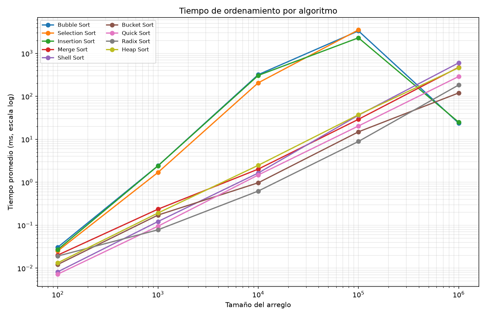
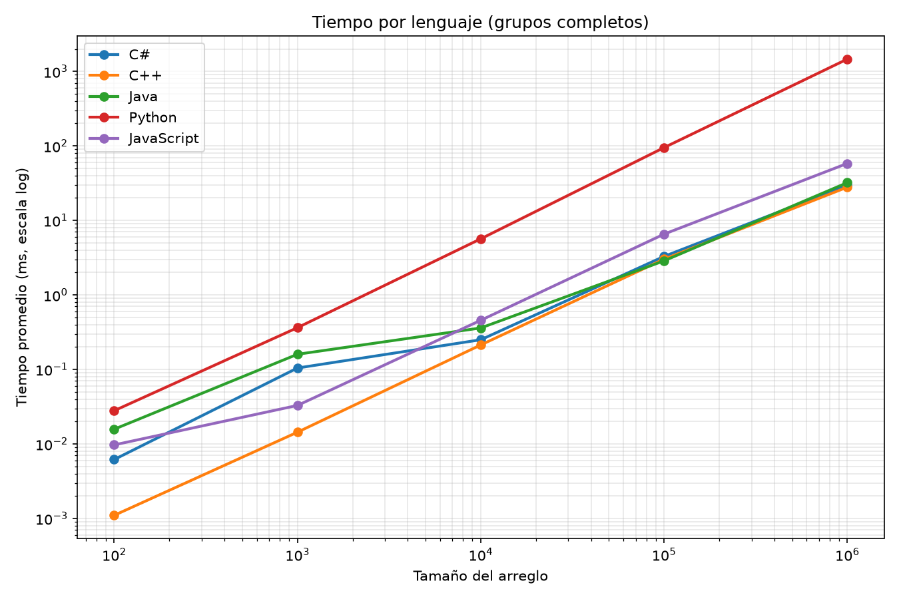
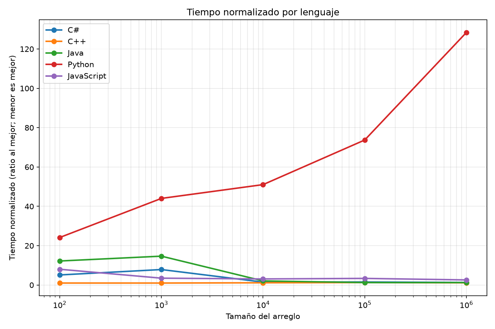

# Benchmark de algoritmos de ordenamiento en 5 lenguajes

Fecha de generación: 2026-10-23 21:22:05

## Entorno de ejecución

- **CPU:** AMD Ryzen 5 8600G w/ Radeon 760M Graphics
- **Núcleos físicos:** 6
- **Núcleos lógicos:** 12
- **RAM:** 15.2 GB
- **Sistema operativo:** Windows-11-10.0.26200-SP0
- **C# / .NET:** 10.0.402
- **C++ (g++):** g++ (Rev5, Built by MSYS2 project) 16.1.0
- **Java (runtime):** java version "21.0.11" 2026-04-21 LTS
- **Java (javac):** javac 21.0.11
- **Python:** Python 3.15.1
- **Node.js:** v26.12.1

## Metodología

Se ejecutaron 9 algoritmos × 5 tamaños × 3 tipos de arreglo = 135 pruebas por lenguaje (675 pruebas en total). Para cada prueba se midió el tiempo en corridas sin contadores: se hicieron 3 repeticiones sobre copias del arreglo original y se reportó la mediana, para reducir el ruido de mediciones puntuales. En una corrida aparte se contaron comparaciones e intercambios. El arreglo base se genera una sola vez por tamaño con un LCG de semilla fija (123456789) y rango 0..1,000,000, idéntico en los 5 lenguajes; cada algoritmo trabaja sobre una copia. Antes de medir se hace una corrida de calentamiento por algoritmo (2,000 elementos) para que la compilación JIT y los caches de cada runtime no distorsionen las pruebas pequeñas; esa corrida no se registra ni se mide. Los timeouts se estiman por algoritmo y tipo de arreglo: Selection Sort es O(n²) siempre y se marca timeout en 1,000,000 (y en Python también en 100,000). Bubble e Insertion se ejecutan en arreglos ordenados porque su salida temprana los hace O(n); con entradas aleatorias o inversas se marcan timeout en 1,000,000 (y en Python también en 100,000).

El tiempo normalizado se calcula por grupo comparable (mismo algoritmo, tamaño y tipo de arreglo): se divide el tiempo de cada lenguaje entre el menor tiempo del grupo y se calcula la media geométrica de esos cocientes. La media geométrica reduce el peso de valores atípicos y de pruebas muy pequeñas, de modo que las pruebas lentas no dominan el resultado. Para comparar lenguajes se usan únicamente grupos completos y balanceados: algoritmos y tipos de arreglo con estado ok en los 5 lenguajes y en los 5 tamaños. Así se evita favorecer a un lenguaje solo porque se saltó pruebas lentas y la mezcla de algoritmos no cambia entre tamaños. Se usa un piso de 0.001 ms para evitar divisiones por cero. Menor puntaje = más rápido. Las filas timeout/error se excluyen de los promedios y se muestran en una tabla aparte. Nota: los tiempos con 100 elementos están cerca de la resolución del reloj y no son confiables para comparar entre lenguajes.

## Resumen ejecutivo

- **Lenguaje más rápido:** **C++** (puntaje normalizado 1.088, menor es mejor; 100 grupos completos).
- **Algoritmo más rápido en general:** **Radix Sort** (puntaje normalizado 2.959, 30 victorias en 75 pruebas).
- **Más rápido con arreglo aleatorio:** **Radix Sort** (puntaje 1.425).
- **Más rápido con arreglo ordenado:** **Bubble Sort** (puntaje 1.065).
- **Más rápido con arreglo inverso:** **Radix Sort** (puntaje 1.500).

## Comparación de lenguajes

| Lenguaje | Puntaje normalizado (menor=mejor) | Tiempo medio, grupos completos (ms) | Pruebas ok | Timeout | Error | Grupos completos |
|---|---|---|---|---|---|---|
| C++ | 1.088 | 6.2333 | 128 | 7 | 0 | 100 |
| C# | 2.191 | 6.6377 | 128 | 7 | 0 | 100 |
| Java | 2.707 | 7.1091 | 128 | 7 | 0 | 100 |
| JavaScript | 2.950 | 13.0461 | 128 | 7 | 0 | 100 |
| Python | 39.216 | 312.6225 | 121 | 14 | 0 | 100 |

El puntaje normalizado permite comparar lenguajes aunque algunos tengan pruebas timeout: solo se usan grupos completos y balanceados. El tiempo medio de la tercera columna es el promedio bruto de esos mismos grupos.

## Comparación de algoritmos

| Algoritmo | Puntaje normalizado (menor=mejor) | Victorias | Pruebas ok | Tiempo medio (ms) |
|---|---|---|---|---|
| Radix Sort | 2.959 | 30 | 75 | 38.6325 |
| Quick Sort | 4.957 | 6 | 75 | 62.2291 |
| Shell Sort | 5.029 | 6 | 75 | 127.7519 |
| Bucket Sort | 9.927 | 9 | 75 | 27.1712 |
| Merge Sort | 9.941 | 0 | 75 | 101.1592 |
| Heap Sort | 10.176 | 0 | 75 | 100.5455 |
| Insertion Sort | 18.842 | 6 | 63 | 549.7756 |
| Bubble Sort | 21.483 | 19 | 63 | 765.7974 |
| Selection Sort | 213.100 | 0 | 57 | 795.2295 |

El puntaje de algoritmos se calcula dentro de cada grupo (lenguaje, tamaño, tipo): se compara cada algoritmo contra el más rápido de ese grupo y se calcula la media geométrica de los cocientes. Las victorias son los grupos donde el algoritmo fue el más rápido (puede haber empates).

### Algoritmos con arreglo aleatorio

| Algoritmo | Puntaje normalizado | Victorias | Pruebas ok |
|---|---|---|---|
| Radix Sort | 1.425 | 17 | 25 |
| Quick Sort | 3.548 | 3 | 25 |
| Bucket Sort | 5.685 | 4 | 25 |
| Heap Sort | 6.310 | 0 | 25 |
| Shell Sort | 7.000 | 1 | 25 |
| Merge Sort | 7.244 | 0 | 25 |
| Insertion Sort | 75.039 | 0 | 19 |
| Selection Sort | 102.144 | 0 | 19 |
| Bubble Sort | 141.951 | 0 | 19 |

### Algoritmos con arreglo ordenado

| Algoritmo | Puntaje normalizado | Victorias | Pruebas ok |
|---|---|---|---|
| Bubble Sort | 1.065 | 19 | 25 |
| Insertion Sort | 1.289 | 6 | 25 |
| Shell Sort | 9.064 | 0 | 25 |
| Radix Sort | 12.124 | 0 | 25 |
| Quick Sort | 12.243 | 0 | 25 |
| Merge Sort | 32.618 | 0 | 25 |
| Heap Sort | 36.015 | 0 | 25 |
| Bucket Sort | 36.948 | 0 | 25 |
| Selection Sort | 785.035 | 0 | 19 |

### Algoritmos con arreglo inverso

| Algoritmo | Puntaje normalizado | Victorias | Pruebas ok |
|---|---|---|---|
| Radix Sort | 1.500 | 13 | 25 |
| Shell Sort | 2.004 | 5 | 25 |
| Quick Sort | 2.804 | 3 | 25 |
| Merge Sort | 4.157 | 0 | 25 |
| Heap Sort | 4.637 | 0 | 25 |
| Bucket Sort | 4.657 | 5 | 25 |
| Selection Sort | 120.684 | 0 | 19 |
| Insertion Sort | 161.250 | 0 | 19 |
| Bubble Sort | 169.453 | 0 | 19 |

## Tablas comparativas por algoritmo y tamaño

### Tiempo promedio (ms) - Todos los tipos de arreglo

| Algoritmo | 100 | 1.000 | 10.000 | 100.000 | 1.000.000 |
|---|---|---|---|---|---|
| Bubble Sort | 0.0307 | 2.4211 | 319.1279 | 3330.9807 | parcial* |
| Selection Sort | 0.0251 | 1.6937 | 206.0651 | 3517.6100 | — |
| Insertion Sort | 0.0271 | 2.4140 | 306.1674 | 2298.6064 | parcial* |
| Merge Sort | 0.0202 | 0.2364 | 2.0207 | 29.1718 | 474.3471 |
| Shell Sort | 0.0082 | 0.1218 | 1.6396 | 36.2661 | 600.7239 |
| Bucket Sort | 0.0122 | 0.1721 | 0.9713 | 14.9082 | 119.7922 |
| Quick Sort | 0.0073 | 0.0948 | 1.4757 | 20.3780 | 289.1896 |
| Radix Sort | 0.0192 | 0.0782 | 0.6232 | 8.9021 | 183.5397 |
| Heap Sort | 0.0133 | 0.1926 | 2.4781 | 37.2263 | 462.8170 |

*solo incluye arreglo ordenado; aleatorio e inverso fueron timeout*

*solo incluye arreglo ordenado; aleatorio e inverso fueron timeout*

### Comparaciones promedio - Todos los tipos de arreglo

| Algoritmo | 100 | 1.000 | 10.000 | 100.000 | 1.000.000 |
|---|---|---|---|---|---|
| Bubble Sort | 3332 | 333288 | 33315018 | 3076748487 | parcial* |
| Selection Sort | 4950 | 499500 | 49995000 | 4999950000 | — |
| Insertion Sort | 2557 | 248507 | 24924635 | 2309637912 | parcial* |
| Merge Sort | 404 | 6233 | 84708 | 1069461 | 12948890 |
| Shell Sort | 531 | 9401 | 142965 | 2147696 | 32291280 |
| Bucket Sort | 50 | 445 | 4471 | 43407 | 2921785 |
| Quick Sort | 771 | 12157 | 171958 | 2228492 | 27219659 |
| Radix Sort | 0 | 0 | 0 | 0 | 0 |
| Heap Sort | 1017 | 16812 | 235507 | 3019578 | 36838687 |

### Intercambios promedio - Todos los tipos de arreglo

| Algoritmo | 100 | 1.000 | 10.000 | 100.000 | 1.000.000 |
|---|---|---|---|---|---|
| Bubble Sort | 2491 | 247842 | 24917956 | 2309567199 | parcial* |
| Selection Sort | 48 | 499 | 5003 | 50741 | — |
| Insertion Sort | 2491 | 247842 | 24917956 | 2309567199 | parcial* |
| Merge Sort | 1344 | 19952 | 267232 | 3337856 | 39902848 |
| Shell Sort | 227 | 4363 | 72096 | 1212069 | 20780594 |
| Bucket Sort | 166 | 1621 | 16273 | 158884 | 4148564 |
| Quick Sort | 454 | 6935 | 98505 | 1216075 | 13841046 |
| Radix Sort | 400 | 4000 | 40000 | 400000 | 4000000 |
| Heap Sort | 577 | 9047 | 124226 | 1574072 | 19050724 |

Las tablas anteriores promedian todos los tests ok (todos los lenguajes y tipos de arreglo) para cada algoritmo y tamaño. Las celdas con «—» indican que no hubo pruebas ok (por ejemplo, timeouts estimados).

### Tiempo promedio (ms) - Arreglo aleatorio

| Algoritmo | 100 | 1.000 | 10.000 | 100.000 | 1.000.000 |
|---|---|---|---|---|---|
| Bubble Sort | 0.0408 | 3.0955 | 414.7939 | 5750.6329 | — |
| Selection Sort | 0.0264 | 1.6838 | 201.7244 | 3443.3229 | — |
| Insertion Sort | 0.0285 | 2.3796 | 316.0312 | 2492.0703 | — |
| Merge Sort | 0.0248 | 0.2576 | 2.4232 | 32.2200 | 465.0386 |
| Shell Sort | 0.0130 | 0.2477 | 3.0880 | 72.8268 | 1111.5875 |
| Bucket Sort | 0.0133 | 0.1389 | 1.1072 | 20.0666 | 137.8678 |
| Quick Sort | 0.0078 | 0.1024 | 1.5576 | 20.2144 | 257.8104 |
| Radix Sort | 0.0194 | 0.0829 | 0.6472 | 8.8989 | 154.7547 |
| Heap Sort | 0.0142 | 0.2041 | 2.6925 | 41.5966 | 567.3907 |

### Tiempo promedio (ms) - Arreglo ordenado

| Algoritmo | 100 | 1.000 | 10.000 | 100.000 | 1.000.000 |
|---|---|---|---|---|---|
| Bubble Sort | 0.0007 | 0.0051 | 0.0510 | 0.6438 | 23.7586 |
| Selection Sort | 0.0268 | 1.6620 | 204.6610 | 3435.8618 | — |
| Insertion Sort | 0.0008 | 0.0062 | 0.0697 | 1.1264 | 24.9704 |
| Merge Sort | 0.0195 | 0.2417 | 1.8241 | 28.2407 | 475.3370 |
| Shell Sort | 0.0039 | 0.0373 | 0.5655 | 12.6171 | 296.1994 |
| Bucket Sort | 0.0108 | 0.2659 | 0.9622 | 12.0680 | 88.8636 |
| Quick Sort | 0.0059 | 0.0709 | 0.9501 | 14.9615 | 220.5840 |
| Radix Sort | 0.0196 | 0.0845 | 0.6084 | 8.8819 | 196.6834 |
| Heap Sort | 0.0140 | 0.1967 | 2.3969 | 34.3838 | 410.1998 |

### Tiempo promedio (ms) - Arreglo inverso

| Algoritmo | 100 | 1.000 | 10.000 | 100.000 | 1.000.000 |
|---|---|---|---|---|---|
| Bubble Sort | 0.0507 | 4.1627 | 542.5389 | 5074.2495 | — |
| Selection Sort | 0.0222 | 1.7353 | 211.8099 | 3673.6453 | — |
| Insertion Sort | 0.0521 | 4.8563 | 602.4014 | 4976.9926 | — |
| Merge Sort | 0.0162 | 0.2099 | 1.8148 | 27.0547 | 482.6657 |
| Shell Sort | 0.0079 | 0.0805 | 1.2653 | 23.3543 | 394.3847 |
| Bucket Sort | 0.0124 | 0.1115 | 0.8444 | 12.5900 | 132.6453 |
| Quick Sort | 0.0081 | 0.1112 | 1.9193 | 25.9580 | 389.1743 |
| Radix Sort | 0.0184 | 0.0671 | 0.6140 | 8.9254 | 199.1809 |
| Heap Sort | 0.0119 | 0.1769 | 2.3449 | 35.6985 | 410.8606 |

### Tiempo promedio por lenguaje y tamaño (grupos completos)

| Lenguaje | 100 | 1.000 | 10.000 | 100.000 | 1.000.000 |
|---|---|---|---|---|---|
| C# | 0.0062 | 0.1044 | 0.2501 | 3.2869 | 29.5407 |
| C++ | 0.0011 | 0.0144 | 0.2129 | 3.0159 | 27.9225 |
| Java | 0.0158 | 0.1597 | 0.3600 | 2.8662 | 32.1437 |
| Python | 0.0279 | 0.3634 | 5.6570 | 94.8725 | 1462.1916 |
| JavaScript | 0.0097 | 0.0329 | 0.4565 | 6.5403 | 58.1909 |

Se usan los mismos algoritmos y tipos de arreglo en todos los tamaños (grupos completos y balanceados), de modo que los valores sean comparables entre filas y columnas.

## Pruebas con timeout o error

| Lenguaje | Timeout | Error |
|---|---|---|
| C# | 7 | 0 |
| C++ | 7 | 0 |
| Java | 7 | 0 |
| Python | 14 | 0 |
| JavaScript | 7 | 0 |

Detalle de las pruebas no exitosas (se excluyeron de todos los promedios):

| Lenguaje | Algoritmo | Tamaño | Tipo de arreglo | Estado |
|---|---|---|---|---|
| C# | Bubble Sort | 1.000.000 | aleatorio | timeout |
| C# | Bubble Sort | 1.000.000 | inverso | timeout |
| C# | Selection Sort | 1.000.000 | aleatorio | timeout |
| C# | Selection Sort | 1.000.000 | ordenado | timeout |
| C# | Selection Sort | 1.000.000 | inverso | timeout |
| C# | Insertion Sort | 1.000.000 | aleatorio | timeout |
| C# | Insertion Sort | 1.000.000 | inverso | timeout |
| C++ | Bubble Sort | 1.000.000 | aleatorio | timeout |
| C++ | Bubble Sort | 1.000.000 | inverso | timeout |
| C++ | Selection Sort | 1.000.000 | aleatorio | timeout |
| C++ | Selection Sort | 1.000.000 | ordenado | timeout |
| C++ | Selection Sort | 1.000.000 | inverso | timeout |
| C++ | Insertion Sort | 1.000.000 | aleatorio | timeout |
| C++ | Insertion Sort | 1.000.000 | inverso | timeout |
| Java | Bubble Sort | 1.000.000 | aleatorio | timeout |
| Java | Bubble Sort | 1.000.000 | inverso | timeout |
| Java | Selection Sort | 1.000.000 | aleatorio | timeout |
| Java | Selection Sort | 1.000.000 | ordenado | timeout |
| Java | Selection Sort | 1.000.000 | inverso | timeout |
| Java | Insertion Sort | 1.000.000 | aleatorio | timeout |
| Java | Insertion Sort | 1.000.000 | inverso | timeout |
| Python | Bubble Sort | 100.000 | aleatorio | timeout |
| Python | Bubble Sort | 100.000 | inverso | timeout |
| Python | Selection Sort | 100.000 | aleatorio | timeout |
| Python | Selection Sort | 100.000 | ordenado | timeout |
| Python | Selection Sort | 100.000 | inverso | timeout |
| Python | Insertion Sort | 100.000 | aleatorio | timeout |
| Python | Insertion Sort | 100.000 | inverso | timeout |
| Python | Bubble Sort | 1.000.000 | aleatorio | timeout |
| Python | Bubble Sort | 1.000.000 | inverso | timeout |
| Python | Selection Sort | 1.000.000 | aleatorio | timeout |
| Python | Selection Sort | 1.000.000 | ordenado | timeout |
| Python | Selection Sort | 1.000.000 | inverso | timeout |
| Python | Insertion Sort | 1.000.000 | aleatorio | timeout |
| Python | Insertion Sort | 1.000.000 | inverso | timeout |
| JavaScript | Bubble Sort | 1.000.000 | aleatorio | timeout |
| JavaScript | Bubble Sort | 1.000.000 | inverso | timeout |
| JavaScript | Selection Sort | 1.000.000 | aleatorio | timeout |
| JavaScript | Selection Sort | 1.000.000 | ordenado | timeout |
| JavaScript | Selection Sort | 1.000.000 | inverso | timeout |
| JavaScript | Insertion Sort | 1.000.000 | aleatorio | timeout |
| JavaScript | Insertion Sort | 1.000.000 | inverso | timeout |

## Gráficas

## Anexo: tiempo promedio (ms) por lenguaje, algoritmo y tamaño

### C#

| Algoritmo | 100 | 1.000 | 10.000 | 100.000 | 1.000.000 |
|---|---|---|---|---|---|
| Bubble Sort | 0.0132 | 0.2758 | 21.1610 | 3341.3468 | 0.5562 |
| Selection Sort | 0.0100 | 0.2403 | 21.0675 | 2045.7930 | — |
| Insertion Sort | 0.0074 | 0.1453 | 13.9527 | 1410.8164 | 0.6405 |
| Merge Sort | 0.0094 | 0.1862 | 0.2858 | 3.1068 | 38.3236 |
| Shell Sort | 0.0027 | 0.0243 | 0.1961 | 2.7455 | 33.8357 |
| Bucket Sort | 0.0056 | 0.2662 | 0.3335 | 9.3107 | 43.7380 |
| Quick Sort | 0.0072 | 0.0734 | 0.3289 | 2.1376 | 28.1830 |
| Radix Sort | 0.0053 | 0.0121 | 0.0495 | 0.5502 | 5.8238 |
| Heap Sort | 0.0105 | 0.1313 | 0.4671 | 4.0193 | 46.6353 |

### C++

| Algoritmo | 100 | 1.000 | 10.000 | 100.000 | 1.000.000 |
|---|---|---|---|---|---|
| Bubble Sort | 0.0019 | 0.1578 | 15.2977 | 1656.1117 | 0.4128 |
| Selection Sort | 0.0057 | 0.6734 | 70.8005 | 7023.5203 | — |
| Insertion Sort | 0.0012 | 0.0991 | 10.0210 | 1011.4823 | 0.6157 |
| Merge Sort | 0.0010 | 0.0121 | 0.2060 | 2.6401 | 31.8212 |
| Shell Sort | 0.0005 | 0.0085 | 0.1737 | 2.3490 | 34.3137 |
| Bucket Sort | 0.0031 | 0.0404 | 0.4504 | 7.7505 | 37.2850 |
| Quick Sort | 0.0006 | 0.0089 | 0.1676 | 2.2127 | 27.0453 |
| Radix Sort | 0.0006 | 0.0032 | 0.0412 | 0.4193 | 5.1399 |
| Heap Sort | 0.0014 | 0.0224 | 0.3772 | 4.7010 | 50.2018 |

### Java

| Algoritmo | 100 | 1.000 | 10.000 | 100.000 | 1.000.000 |
|---|---|---|---|---|---|
| Bubble Sort | 0.0163 | 0.3066 | 14.7328 | 2926.0894 | 0.2563 |
| Selection Sort | 0.0290 | 0.1744 | 16.4893 | 1736.7070 | — |
| Insertion Sort | 0.0133 | 0.3101 | 10.7291 | 1014.0581 | 0.4148 |
| Merge Sort | 0.0260 | 0.3584 | 0.3906 | 4.2096 | 54.8171 |
| Shell Sort | 0.0161 | 0.1917 | 0.2535 | 2.5867 | 35.8994 |
| Bucket Sort | 0.0286 | 0.3366 | 0.8948 | 5.5595 | 41.9627 |
| Quick Sort | 0.0016 | 0.0128 | 0.2153 | 2.5298 | 31.4758 |
| Radix Sort | 0.0263 | 0.0959 | 0.1660 | 0.4786 | 4.6643 |
| Heap Sort | 0.0062 | 0.0675 | 0.4778 | 3.7221 | 45.2480 |

### Python

| Algoritmo | 100 | 1.000 | 10.000 | 100.000 | 1.000.000 |
|---|---|---|---|---|---|
| Bubble Sort | 0.1147 | 10.7269 | 1483.0120 | 3.0060 | 116.6042 |
| Selection Sort | 0.0758 | 7.0387 | 889.5021 | — | — |
| Insertion Sort | 0.1072 | 10.8243 | 1431.5103 | 5.3293 | 122.5561 |
| Merge Sort | 0.0423 | 0.5816 | 8.7078 | 129.1423 | 2166.6759 |
| Shell Sort | 0.0195 | 0.3522 | 6.9432 | 164.6534 | 2768.5490 |
| Bucket Sort | 0.0154 | 0.1681 | 2.2909 | 36.7731 | 440.8589 |
| Quick Sort | 0.0251 | 0.3539 | 6.3110 | 90.6058 | 1305.4238 |
| Radix Sort | 0.0383 | 0.2605 | 2.7479 | 41.4801 | 893.7758 |
| Heap Sort | 0.0440 | 0.6929 | 10.5315 | 167.0499 | 2092.9406 |

### JavaScript

| Algoritmo | 100 | 1.000 | 10.000 | 100.000 | 1.000.000 |
|---|---|---|---|---|---|
| Bubble Sort | 0.0074 | 0.6384 | 61.4361 | 6509.6997 | 0.9635 |
| Selection Sort | 0.0053 | 0.3416 | 32.4661 | 3264.4197 | — |
| Insertion Sort | 0.0065 | 0.6912 | 64.6240 | 6522.4947 | 0.6250 |
| Merge Sort | 0.0222 | 0.0437 | 0.5133 | 6.7600 | 80.0977 |
| Shell Sort | 0.0023 | 0.0324 | 0.6314 | 8.9958 | 131.0216 |
| Bucket Sort | 0.0082 | 0.0491 | 0.8867 | 15.1471 | 35.1166 |
| Quick Sort | 0.0018 | 0.0252 | 0.3558 | 4.4042 | 53.8199 |
| Radix Sort | 0.0253 | 0.0191 | 0.1114 | 1.5822 | 8.2947 |
| Heap Sort | 0.0046 | 0.0487 | 0.5370 | 6.6391 | 79.0594 |

## Conclusiones

- El lenguaje más rápido, según el tiempo promedio normalizado sobre grupos completos y balanceados, es **C++** (puntaje 1.088).
- El algoritmo más rápido en general es **Radix Sort** (puntaje 2.959).
- Por tipo de entrada: aleatorio → **Radix Sort**, ordenado → **Bubble Sort**, inverso → **Radix Sort**.
- Bubble Sort incluye salida temprana: en un arreglo ya ordenado hace solo O(n) comparaciones y ningún intercambio, por eso resulta el más rápido para ese tipo de entrada.
- **Tamaño 1,000,000 - Algoritmo más rápido por lenguaje (con datos completos):**
  - C#: **Radix Sort** (5.8238 ms)
  - C++: **Radix Sort** (5.1399 ms)
  - Java: **Radix Sort** (4.6643 ms)
  - Python: **Bucket Sort** (440.8589 ms)
  - JavaScript: **Radix Sort** (8.2947 ms)
- El promedio bruto entre lenguajes está dominado por Python y por eso no se usa para concluir.
- Se registraron 42 timeouts y 0 errores de un total de 675 pruebas. Los timeouts corresponden principalmente a Bubble/Selection/Insertion en tamaños grandes, estimados antes de ejecutar.
- Radix Sort registra 0 comparaciones por diseño (no compara elementos). En Merge, Radix y Bucket los movimientos/escrituras se cuentan como intercambios, según la convención documentada en cada programa.
